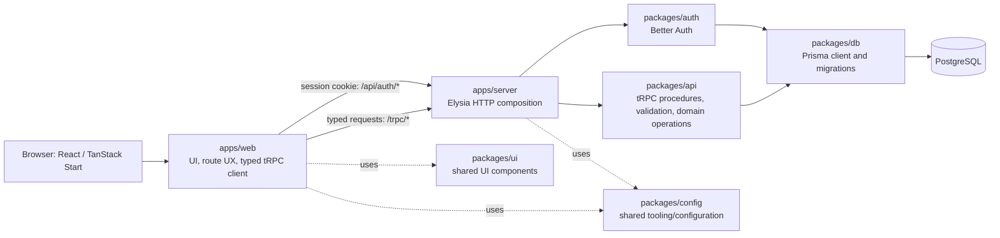
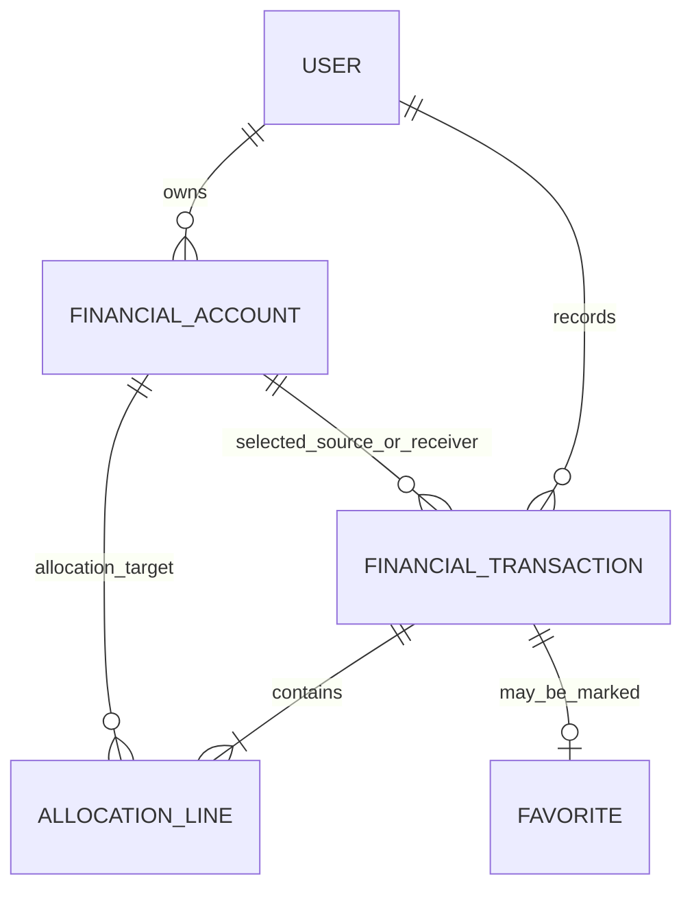

# System-Level Software Design Specification — Pockit

**Version:** 0.1 — Sprint 1 design baseline
**Status:** Draft for teammate review; implementation details remain subject to feature-level contracts
**Parent:** [Issue #5 — Sprint 1: System-Level SDS](https://github.com/ovenmakemeheat/Pockit/issues/5)
**Requirements baseline:** [Software Requirements Specification](../requirements/srs.md)
**Project brief:** `docs/assignments/final/group_work_specs_v1.pdf`, section 6, theme 7

This specification describes how the approved product scope maps to Pockit's architecture and domain model. It distinguishes existing repository capabilities from planned product behavior. It does not claim that the financial domain, role authorization, or deployment targets are already implemented.

## 1. System context and design principles

Pockit is a persistent full-stack personal-finance system. A User manages only their own Accounts, Transactions, favorites, balances, and summaries. An Administrator manages platform User access but is never allowed to view or modify financial records or summaries.

The design follows these principles:

1. **Server-authoritative privacy:** derive identity from the authenticated session; never accept a client-supplied owner as authority. Enforce role and ownership checks in API operations, not just routes or UI.
2. **Persistent financial source of truth:** PostgreSQL stores accepted financial records. Browser state and derived UI summaries are not authoritative.
3. **Exact, atomic financial operations:** use exact decimal arithmetic and commit a Transaction and all allocation lines together or reject the operation without partial effects.
4. **Existing workspace boundaries:** build on the Bun monorepo and its current packages. Avoid a second server framework or a new package unless a later bounded contract justifies one.
5. **Document uncertainty:** unresolved SRS questions remain open until approved; feature-level SDSs must settle the decisions needed by their implementation.

### 1.1 Current implementation and planned product boundary

| Area | Present in the repository | Planned by the approved product design |
| --- | --- | --- |
| Web | React 19, TanStack Start/Router, TanStack Query, typed tRPC client, Better Auth client, Tailwind/shadcn UI. The protected route currently performs a client-side session check. | Login and authenticated finance workflows, with UI route guards as a usability layer only. |
| HTTP/API server | Elysia exposes Better Auth at `/api/auth/*`, tRPC at `/trpc/*`, and a health endpoint. | Financial and administration procedures with server-side role and owner checks. |
| API package | tRPC router and a `protectedProcedure` that currently verifies only that a session exists. | Domain input validation, authorization boundaries, financial operations, and summaries. A session alone is not sufficient authorization. |
| Authentication | Better Auth email/password configuration with a Prisma/PostgreSQL adapter and database-backed sessions. | Seeded demo identities, role and enabled-status enforcement, and documented session lifecycle. |
| Database | Prisma 7 with PostgreSQL and versioned migrations; current schema contains Better Auth identity/session models only. | User-owned financial Accounts, Transactions, allocation lines, and any required role/status fields. |
| Deployment | Dockerfiles and Compose files support local web/server containers and a separate persistent PostgreSQL development service. | Reproducible Docker delivery and a later GCP deployment, scheduled for Lab 5 rather than a Sprint 1 prerequisite. |

## 2. Architecture and component responsibilities

### 2.1 Logical architecture

### 2.2 Responsibilities and request flow

| Component | Responsibility and boundary |
| --- | --- |
| `apps/web` | Render the User and Administrator experiences; use Better Auth for authentication and the typed tRPC client for application operations. UI hiding and route guards improve navigation but do not grant or deny data access. Browser money values cross the API as decimal strings, never JavaScript floating-point values. |
| `apps/server` | Compose the Elysia HTTP application, CORS policy, Better Auth routes, tRPC fetch handler, and request context. The context resolves the Better Auth session from request headers and makes the database available to API procedures. It is the HTTP boundary, not the owner of finance rules. |
| `packages/auth` | Configure Better Auth and its Prisma adapter; manage credential authentication and persistent sessions. Identity, role, and enabled status must be available to authorization checks. Passwords must be stored only as suitable hashes when managed by the application. |
| `packages/api` | Define the typed tRPC API, input schemas, authorization procedures, and application/domain operations. Keep business invariants server-side. Procedures must resolve the User from the session and constrain every finance query/mutation to that User. |
| `packages/db` | Own Prisma client setup, database schema, and versioned migrations. Persist Better Auth and financial data in PostgreSQL. Database constraints and transactions backstop API validation. |
| `packages/ui` | Provide shared presentation components; no domain authorization or financial persistence. |
| `packages/config` | Share tooling and configuration conventions; do not put secrets or runtime financial state here. |

The planned request path is: browser request → Elysia route → request context/session resolution → API authentication and role/ownership checks → validated domain operation → Prisma/PostgreSQL. For Better Auth endpoints, Elysia delegates to Better Auth. The session cookie is sent with credentialed web requests; the backend remains authoritative even if a caller bypasses the web UI.

No new application package is required by this system design. If domain services grow beyond a clear boundary in `packages/api`, a later architectural decision may propose a package rather than duplicating behavior across apps.

## 3. Logical data model

This is a logical model, not the final Prisma schema. Exact field types, indexes, deletion behavior, migrations, and date representation belong in the applicable feature-level SDS and data specification.

### 3.1 Entities and relationships

| Entity | Key information | Relationships and invariants |
| --- | --- | --- |
| **User** | Better Auth identity plus application role (`User` or `Administrator`) and enabled/disabled status. | One User owns many Financial Accounts and Transactions. Administrators manage platform access but are never granted finance access. Disabling a User immediately revokes all stored sessions, prevents new sessions, and denies subsequent protected requests (ADR-0002). |
| **Financial Account** | Owner User, display name, one of the five Account types, currency, and opening-balance information where applicable. The finance entity should be named `FinancialAccount` (or an equally unambiguous name), not Better Auth's existing Prisma `Account` model. | Belongs to exactly one User. A User owns zero or more. Account type constrains where it can be used as a source, receiver, or allocation destination. |
| **Financial Transaction** | Owner User, form (`payment/charge` or `receive money`), total amount, transaction date, selected source/receiving Account, and optional description. | Belongs to exactly one User; has one or more allocation lines. The selected Account and every allocation Account must belong to the same owner. |
| **Allocation line** | Parent Transaction, destination/counterpart Account, exact amount, and an operation/direction where needed to distinguish transfer, borrowing, or repayment. | Belongs to one Transaction and references a Financial Account. At least one line is required; the exact sum equals the parent total. |
| **Favorite association** | Existing Transaction marked as a favorite by its owner. | References an existing Transaction and its owning User; cannot expose another User's Transaction. A field or separate relation is an implementation detail for the feature contract. |

### 3.2 Five Account types

| Type | Meaning and balance interpretation |
| --- | --- |
| **Cash** | Bank account or wallet. Its balance increases on receipt and decreases on payment; a Cash-to-Cash transfer changes both Accounts by equal and opposite amounts. |
| **Loan Given** | Money owed to the User. Lending increases the receivable; repayment decreases it. It is not Income. |
| **Loan Taken** | Credit-card or other borrowed-money debt. Borrowing or a charge increases outstanding debt; repayment decreases it. It is not Expense merely because it is repaid. |
| **Income** | Category for income activity. Its total increases only from an Income allocation, not from a transfer, borrowing, opening balance, or loan repayment. |
| **Expense** | Category for spending activity. Its total increases only from an Expense allocation, not from a transfer, borrowing, opening balance, or loan repayment. |

Cash, Loan Given, and Loan Taken have balance-bearing natural balances. Income and Expense are classification totals, not cash-like spendable balances. Whether category Accounts can have nonzero opening balances is not established by the SRS; do not infer it in implementation without an approved feature decision.

## 4. Transaction and balance behavior

### 4.1 Transaction forms and valid allocations

| Form | Selected Account | Allocation destinations |
| --- | --- | --- |
| **Payment or charge** | Cash used for payment, or Loan Taken used for a charge. | Expense; repayment of Loan Taken; lending to Loan Given; or transfer to another Cash Account. |
| **Receive money** | Cash receiving the funds. | Income; repayment of Loan Given; new borrowing into Loan Taken; or transfer from another Cash Account. |

A Transaction must have at least one allocation line. Its allocation amounts must add exactly to its total. The API validates the form, source/receiver Account type, each allocation Account type and owner, amount precision, and total before commit. Invalid input is rejected without a persisted partial Transaction or any partial balance effect.

### 4.2 Balance and summary calculation

**Authoritative rule:** balances and category totals are derived from the persisted opening position plus committed Transaction effects. The Transaction/allocation ledger is authoritative; a cached aggregate, if introduced later for performance, is rebuildable and must not become an independent source of truth.

Use the following natural-balance effects, applying each allocation amount exactly once:

| Event | Effect |
| --- | --- |
| Opening position | Establish the starting balance of a balance-bearing Account; it is not Income or Expense. The account type determines whether the natural balance represents Cash, receivable, or debt. |
| Payment/charge selected from Cash | Decrease the selected Cash balance by the Transaction total. |
| Payment/charge selected from Loan Taken | Increase that Loan Taken Account's outstanding debt by the Transaction total. |
| Receive-money Transaction | Increase the selected receiving Cash Account by the Transaction total. |
| Expense allocation | Increase the Expense category total by that allocation amount. |
| Income allocation | Increase the Income category total by that allocation amount. |
| Loan Taken repayment allocation | Decrease the referenced Loan Taken outstanding debt. It does not create Income or Expense. |
| New Loan Taken borrowing allocation | Increase the referenced Loan Taken outstanding debt. It does not create Income or Expense. |
| Loan Given lending allocation | Increase the referenced Loan Given receivable. It does not create Income or Expense. |
| Loan Given repayment allocation | Decrease the referenced Loan Given receivable. It does not create Income or Expense. |
| Cash transfer allocation | Increase the destination Cash balance for an outgoing transfer, or decrease the source Cash balance for an incoming transfer. The counterpart effect must be equal and opposite; neither side is Income or Expense. |

An income/expense summary sums only the corresponding categorized allocations over its requested scope; category spending sums Expense allocations by Expense Account. Account balance, debt/receivable, summary, and history queries must be derived from the same committed records and scoped to the current User. For Sprint 1, summaries are all-time totals without an implicit date filter; date-filtered reporting remains later work.

### 4.3 Atomicity and persistence

Create the Transaction header and all allocation lines in one PostgreSQL transaction. Validate all references and exact totals before commit. Any failure rolls back the whole operation. Account ownership must be checked for the selected source/receiver and each allocation destination, not only the Transaction owner. A successful commit is visible to subsequent balance, summary, and history reads and survives application restarts.

## 5. UI and API structure

### 5.1 Planned UI areas

- **Public:** login and authentication feedback.
- **User:** dashboard (balances, debt, income/expense summary), Account views, transaction create/history/detail, category spending, and later favorites/duplicate flows.
- **Administrator:** platform User list and enable/disable access controls only. No finance navigation, finance query, financial summary, or financial record detail is available to this role.

The precise routes and screen-level workflows are defined in feature contracts. Client route guards do not replace API checks. Do not add self-registration, password recovery, or email verification unless separately approved; seeded demo Users are sufficient.

### 5.2 Planned API boundaries

Keep the existing tRPC transport and type inference. The following are logical router areas, not promises about final procedure names:

| API area | Intended operations | Authorization boundary |
| --- | --- | --- |
| Authentication | Better Auth login, logout, and current session/identity. | Public login; session required for identity and protected app operations. |
| Accounts | Read and manage the current User's Financial Accounts, opening balances, and balances. | User-owned finance operations only; Administrator denied. |
| Transactions | Create/read history and details; later correction and duplication. | Session + User role + owner checks on Transaction and every referenced Account. |
| Summaries | Account balances, debt/receivables, income/expense totals, category spending. | User role only; query scope always derived from session identity. |
| Favorites | Mark/unmark and list the current User's favorite Transactions. | User role and Transaction ownership; Administrator denied. |
| Administrator User access | List/manage platform User access and enabled status. | Administrator only; response fields must not include finance records or summaries. |

The current `protectedProcedure` verifies session presence only. Before these routers are treated as complete, add explicit role- and owner-aware server procedures or equivalent centralized checks. Do not make an Administrator a finance `User` merely because the session is authenticated.

### 5.3 Money API representation

Represent monetary values crossing JSON/API boundaries as base-10 decimal strings (for example, `"123.45"`), not JavaScript `number`. Validate strings against the configured currency precision, parse into exact decimal/integer arithmetic in the server/domain layer, and persist using PostgreSQL `NUMERIC`/Prisma `Decimal` or an equivalently exact representation. Serialize back to decimal strings. Never use IEEE-754 binary floating-point for monetary arithmetic, equality, allocation totals, or persisted balances.

## 6. Roles, permissions, and privacy

| Operation | Unauthenticated visitor | User | Administrator |
| --- | --- | --- | --- |
| Login | Allowed | Allowed | Allowed |
| Logout/current identity | No session / rejected | Own session only | Own session only |
| Read or change own financial Accounts/Transactions/favorites | Rejected | Allowed, own records only | **Forbidden** |
| Read another User's financial data | **Forbidden** | **Forbidden** | **Forbidden** |
| Read financial summaries or category spending | **Forbidden** | Allowed, own records only | **Forbidden** |
| Manage platform User access and enabled status | **Forbidden** | **Forbidden** | Allowed, excluding financial data |

Enforce this matrix at backend/API boundaries for every operation, including nested IDs, filters, batch requests, and summaries. Queries must include the session-derived owner constraint; mutations must verify ownership of all records being changed or referenced. UI visibility is not authorization. Test Administrator access attempts against finance endpoints explicitly, including summary endpoints and any generic lookup.

An Administrator's access-management response must be limited to platform identity/access information needed for that function. It must not join, return, or aggregate financial entities. Disabling a User atomically updates enabled status and deletes all persisted sessions. Better Auth session creation rejects disabled Users; with cookie session caching disabled, subsequent requests resolve the missing stored session as unauthenticated. The server also rejects a session whose current User status is disabled.

## 7. Configuration, authentication, and secret handling

### 7.1 Configuration boundary

The repository uses Varlock schemas and local ignored `.env` files. Existing configuration includes:

| Configuration | Consumer | Handling |
| --- | --- | --- |
| `DATABASE_URL` | Server and Prisma | Secret; use local ignored environment file in development and the deployment secret store in production. |
| `BETTER_AUTH_SECRET` | Server/Better Auth | Secret; minimum 32 characters per current schema. Do not put in source, Docker build args, browser configuration, or logs. |
| `BETTER_AUTH_URL` | Server/Better Auth | Server runtime URL; environment-specific. |
| `CORS_ORIGIN` | Server | Explicit trusted browser origin; avoid permissive wildcard configuration with credentialed requests. |
| `VITE_SERVER_URL` | Web | Public server endpoint; it is a client-visible URL, not a secret. |
| `SERVER_URL` | Web server-side rendering | Internal/server-side API URL where applicable; do not expose internal credentials through it. |
| `NODE_ENV` | Apps/packages | Environment mode validated through schemas. |

Keep schemas/examples current when configuration changes, keep local secrets in ignored files, and verify the staged diff contains no credentials or real financial data. Docker BuildKit secret mounts may provide local build-time files, but production runtime secrets must be delivered through the deployment secret mechanism, not baked into an image.

### 7.2 Session lifecycle

Better Auth uses email/password authentication with Prisma-backed PostgreSQL sessions. The browser client sends credentials with API requests. The current server configuration sets session cookies to `HttpOnly`, `Secure`, and `SameSite=None`; production must retain secure cookie protections and validate trusted origins. Login creates a server-validated session; protected requests resolve the stored session from request headers; logout invalidates the session using Better Auth. The configured expiry is seven days with renewal after one day. When an Administrator disables a User, the same database transaction marks the User disabled and deletes all stored sessions. A Better Auth session-create hook rejects new sessions for disabled Users, and backend protected procedures recheck enabled status. Existing browser cookies may remain until cleared/expired, but cannot authenticate after the stored sessions are deleted. There is no cookie session cache. See ADR-0002; exact cookie behavior remains subject to the auth HTTP tests.

## 8. Deployment architecture

### 8.1 Local development

- `docker-compose.yml` runs separate web and API/server containers and supplies local service URLs.
- `docker-compose.db.yml` runs PostgreSQL 17 with a persistent named volume and a host-local port binding.
- Versioned Prisma migrations define schema changes. Run migrations as a controlled setup/release step; do not use schema push as a substitute for reviewed migrations.
- Local database credentials in examples are synthetic development-only values. They are not production credentials.

### 8.2 Planned Docker and GCP delivery

The product remains database-backed and persistent in every environment. The later GCP target is:

- Build web and server images and publish them to **Artifact Registry**.
- Run the stateless web and API/server containers as **Cloud Run** services; the web service calls the public API endpoint, and the API connects privately/securely to the database.
- Store persistent PostgreSQL data in **Cloud SQL**, not a container filesystem or Cloud Run instance memory.
- Deliver production secrets via **Secret Manager** and runtime environment configuration; use **Cloud Logging** for operational logs without logging credentials or financial payloads.
- Use **GitHub Actions** with **Workload Identity Federation** for CI/CD authentication rather than a long-lived service-account key.
- Apply versioned migrations through a controlled release job or deployment step before traffic uses a schema change.

This is a planned Lab 5 deployment direction, not a claim of existing cloud resources or a Sprint 1 release prerequisite. Confirm exact course-required services and deployment steps during the Lab 5 feature contract. Before Cloud Run deployment, the current server entry point must be changed from its hard-coded port to the platform-provided `PORT` and bind to the required network interface; health checks and external service URLs must also be deployment-configured. Container filesystems and process memory are not durable storage.

## 9. Explicit money decisions and unresolved items

Sprint 1 decisions are recorded in [ADR-0001](../adr/0001-sprint1-money-and-date-policies.md). The ADR records the product owner's delegated currency choice and the user's report that the other selected policies were confirmed with the team/course; the PR for Issue #8 requests teammate review before merge.

1. **Sprint 1 currency:** THB only, with two fractional digits. This choice scopes the Sprint 1 demonstration and does not decide whether later releases support more currencies.
2. **Exact representation:** API/UI money values are decimal strings. Convert to exact integer minor units for calculations and persistence; never use JavaScript binary floating-point for money. Serialize values with exactly two fractional digits.
3. **Precision/rounding:** reject inputs with more than two fractional digits. Do not implicitly round posted Transactions, allocations, balances, or Sprint 1 summaries. Any future operation requiring rounding must specify and approve its rule first.
4. **Allocation equality:** compare exact minor-unit integers and require allocation sum = Transaction total before commit.
5. **Balance calculation:** derive natural balances and category totals from opening positions plus committed postings as defined in Section 4.2. Opening balances, transfers, borrowing, and loan repayments are never classified as Income or Expense.
6. **Transaction date/reporting:** require an explicit `YYYY-MM-DD` date, preserve it without timezone conversion, and use all-time summaries by default with no implicit date filter. Later date filtering needs a separate contract.
7. **Amount boundaries:** Sprint 1 values must be positive; reject repayments above Loan Taken debt and Cash outflows above available balance. No product-specific maximum amount or allocation-line limit is defined. OQ-07 remains open for any future limit.
8. **Currency compatibility:** Sprint 1 accounts use THB only; do not add conversion or combine unlike currencies. Other currencies and cross-currency behavior remain unresolved (OQ-01).

The System-Level balance formulas, exact representation, and Sprint 1 policies are explicit; OQ-01 remains open only for currencies beyond THB, OQ-04 and OQ-06 remain unresolved, and OQ-07 remains open for any future maximum or allocation-count limit. OQ-05 is resolved by ADR-0002.

## 10. Requirement-to-design traceability

| SRS requirements | Design support |
| --- | --- |
| FR-01, FR-02, FR-03; BR-08, BR-11; NFR-01, NFR-07 | Better Auth identity/session boundary, User role/status, role/ownership matrix, server-side authorization; Admin finance denial. |
| FR-04, FR-05, FR-14; BR-01, BR-05 | Financial Account model, five Account types, opening position, seeded synthetic data, PostgreSQL persistence. |
| FR-06, FR-07, FR-08; BR-02, BR-03, BR-04 | Two Transaction forms, typed allocation lines, exact total validation, account type and owner validation, atomic writes. |
| FR-09, FR-10; BR-05, BR-06, BR-07; NFR-02, NFR-03, NFR-04 | Ledger-derived balances and summaries, exact monetary representation, persistent data, no partial effects, no misclassification of transfer/debt activity. |
| FR-11, FR-12; BR-09 | Owner-scoped favorite association and distinct editable duplication behavior in later feature contracts. |
| FR-13 | Transaction correction/history design deferred until SRS OQ-04 is resolved; history query remains owner-scoped. |
| NFR-05, NFR-06 | Varlock/environment-secret policy, synthetic data, test/evidence requirements, versioned migrations. |

The feature inventory and three-sprint plan own the detailed feature-to-sprint allocation. This SDS does not override their reviewed decisions or assign unscheduled later-sprint features.

## 11. Verification approach and design checks

### 11.1 Test seams for future implementation

Test at the highest useful external seam. The primary seams are:

1. **API procedure/integration seam:** invoke tRPC procedures with synthetic sessions and database fixtures to verify externally observable authorization, validation, result, and error behavior.
2. **Database-backed operation seam:** use PostgreSQL and the real Prisma adapter to verify persistence, transaction atomicity, exact allocations, and balance/summary calculations.
3. **HTTP boundary seam where relevant:** exercise Elysia handlers for authentication transport, credentialed requests, and HTTP behavior; avoid testing Elysia internals.
4. **UI workflow seam:** verify user-visible login and finance journeys once screens exist; do not treat mocked UI state as evidence of persistence or server authorization.

Existing tests provide prior art for public/protected tRPC calls, Elysia health/auth method handling, and PostgreSQL connectivity/migration checks. They are foundation tests, not sufficient finance-domain coverage. Feature-level Software Test Specifications must add observable valid, invalid, boundary, cross-User, Administrator-denial, persistence, and business-rule cases and link stable test IDs to acceptance criteria. Keep synthetic Users and financial data in tests.

### 11.2 SDS content validation

| Validation ID | Check | Expected evidence |
| --- | --- | --- |
| **SDS-VAL-01** | Architecture and stack agree with the current repository and distinguish existing capabilities from planned product work. | Review Sections 1–2 against package manifests and application boundaries. |
| **SDS-VAL-02** | Logical data model covers all five Account types, Transaction forms, allocation lines, owner relationships, and favorites. | Review Sections 3–4 against SRS FR/BR scope. |
| **SDS-VAL-03** | UI/API boundaries and business interactions preserve the SRS forms, allocations, and atomicity. | Review Sections 4–5 against FR-06..FR-10 and BR-02..BR-07. |
| **SDS-VAL-04** | User and Administrator permissions explicitly deny Administrator access to finance data and summaries. | Review Section 6; confirm every finance operation has a server-side role/owner boundary. |
| **SDS-VAL-05** | Configuration and secret handling are documented without exposing credentials. | Review Section 7 against Varlock schemas and inspect repository changes for secret values. |
| **SDS-VAL-06** | Docker/GCP deployment is persistent and correctly marked as planned Lab 5 work, not Sprint 1 cloud delivery. | Review Section 8 against Compose files and the Lab 5 deployment guide. |
| **SDS-VAL-07** | Precision, rounding, date, allocation equality, and balance calculations are explicit, with remaining currency/limit questions clearly separated from Sprint 1 decisions. | Review Section 9 and ADR-0001 against SRS BR-10 and the current OQ-01..OQ-03/OQ-07 status. |

This is a documentation deliverable. Application behavior is not certified by these content checks; implementation and behavior tests are owned by later feature contracts and Issue #8.

## 12. Open questions and decision ownership

| SRS question | Design implication / resolution point |
| --- | --- |
| OQ-01 — currency and precision | THB with two fractional digits is selected for Sprint 1 by Guntee under explicit delegation; teammate review is pending in Issue #8. Other currencies, conversion, and mixed-currency behavior remain open. |
| OQ-02 — rounding and excess precision | Sprint 1 rejects values beyond two fractional digits and does not implicitly round; Guntee reports this decision confirmed with the team/course. Future rounding needs a separate rule. |
| OQ-03 — date/time zone and default Transaction date | Sprint 1 requires explicit `YYYY-MM-DD`, no timezone conversion/default, and all-time summaries; Guntee reports confirmation with the team/course. Future filters need a separate contract. |
| OQ-04 — correction and audit | Decide edit/delete/correction and historical audit behavior before implementing correction. |
| OQ-05 — disabled-session revocation | Resolved by ADR-0002: immediate persisted-session deletion, new-session rejection, and protected-request denial. Implementation and teammate review remain in Issue #8. |
| OQ-06 — performance/browser/accessibility targets | Set measurable release targets before release acceptance. |
| OQ-07 — amount limits and invalid values | Sprint 1 rejects non-positive amounts, repayment above debt, and Cash outflow above balance; no product-specific maximum or allocation-line count is defined. Guntee reports team/course confirmation. Future limits remain open. |

## 13. Review and change control

This system design is subordinate to the approved project brief and SRS. If an implementation requirement conflicts with it, record the conflict and resolve it through a reviewed feature contract or an architecture decision; do not silently expand scope. Physical schema, procedure names, route paths, responsive interaction details, any future currency configuration, and deployment manifests remain bounded implementation decisions for the relevant feature issues.
